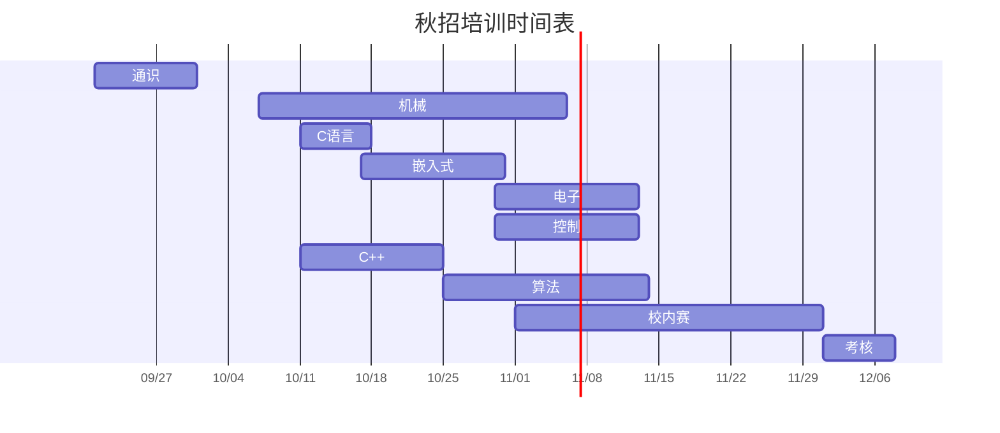

# 培训

培训分为 基础培训 和 梯队培训。

- 秋招面向大一大二零基础同学。
- **基础培训**由技术组开展，成员是各个技术组的老队员，时间约一个月，课程向所有人开放。
- **校内赛**用时一个月，面向所有人。结束后进行**梯队队员考核**，成为梯队队员。
- **梯队培训**面向内部，前期统一布置任务，学习基础知识；后期划分方向，老带新进入兵种组学习。
- 在一年结束后，会面向有基础同学进行夏招，梯队队员和夏招进行**正式队员考核**，成为正式队员。

## 课程链接

  <a href="/training/mech">机械</a>
  <a href="/training/control">电控</a>
  <a href="/training/elec">硬件</a>
  <a href="/training/algo">算法</a>
  <a href="/training/software">软件</a>
  <a href="/training">宣运</a>

## 技术概览

- 通识：RM 比赛、VGD 队伍、了解机器人、正确使用 AI、提问的艺术
- 机械：机械结构及相关机械设计基础
- 电控：C、嵌入式STM32、控制理论
- 硬件：C、嵌入式STM32、PCB、电源与电路基础
- 算法：C++、Linux 和 ROS2、视觉、SLAM感知和自主规划、决策、控制

## 时间轴

